# Mimi: multilingual course tutor and live help (`<db-assistant>`)

**A course tutor in Amharic and English, by voice and text, with a real person one click away.**

- **Team:**
  - Hara Dejene: frontend developer
  - Tsion Birhanu: AI engineer and DevOps
  - Dagmawit Negash: full-stack developer
  - Hermela Kassahun: project manager
- **Try it on Telegram:** [@mimi_tutor_liveBot](https://t.me/mimi_tutor_liveBot) (the free server
  sleeps when idle, so the first reply can take up to a minute)

## What it does

Mimi is a tutor that any learning platform adds with one script tag. She helps in Amharic or English,
by voice or by text, answers only from the course (and the job listings), shows the exact section each
answer comes from, and says plainly when something is not in the course. One button connects the
learner to a person (with screen sharing the learner controls), and the same tutor answers on
Telegram, by SMS and on a no-JavaScript page.

## Who it is for

Learners who get stuck in English, and learners who are blind, Deaf, have low vision or use only a
keyboard. For example: a blind learner on a low-cost Android phone asks in Amharic, by voice, what the
late policy of their course is, hears the answer with its source, and reaches a tutor when the answer
is not enough, with nobody helping.

## A tour of every feature

### 1. She asks before anything leaves the website

On the first visit Mimi asks, in Amharic and English, whether she may use online AI and voice. Until
the learner answers, nothing is spoken, sent or recorded. "No, text only" keeps every answer on the
host's own server.

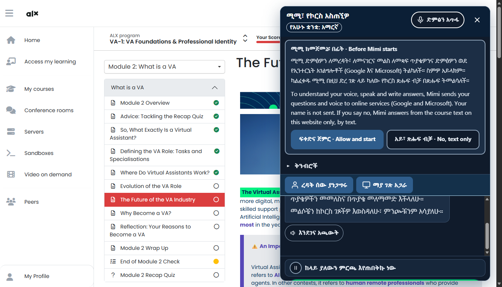

### 2. A greeting in Amharic, and one sentence to switch

Mimi greets the learner in the page's language and says, in the other language's own voice, how to
switch ("For English, say "English", or press 2"). The two big buttons do the same.

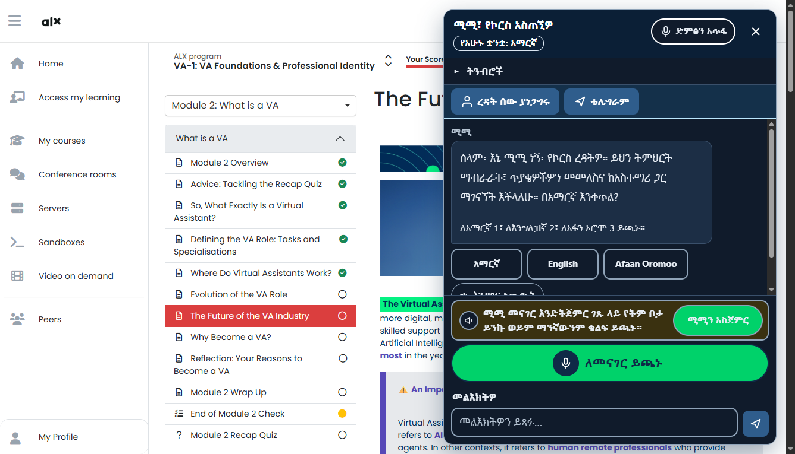

### 3. Press to talk, and see your words as you speak

One large "Press to talk" button. While listening it turns green; the learner's words appear as they
speak (on the right), and Mimi's answer appears word by word as she says it (on the left), so Deaf and
hard-of-hearing learners read exactly what is spoken. The lesson section she is talking about is
outlined on the page.

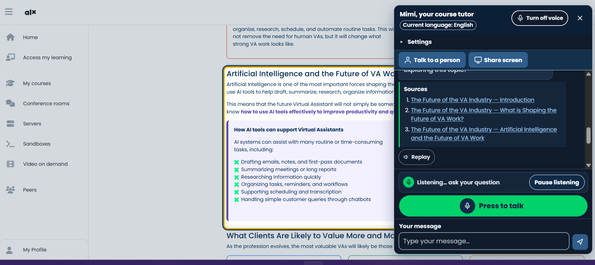

### 4. Every answer shows where it comes from

Each sentence about the course carries a number like [1], and the sources list links straight to the
section of the lesson. A learner can always check the answer.

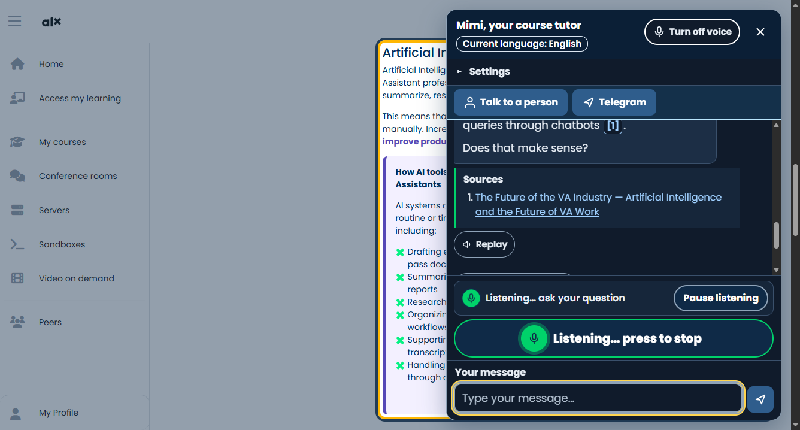

### 5. "I don't know" instead of a made-up answer

A question that is not in the course (here "Who won the World Cup?") is not sent to the AI at all.
Mimi says so plainly and offers a person: press "Talk to a person", or just say "4". Shown here in
dark mode, on a plain page with no Savanna styles: Mimi works on any website.

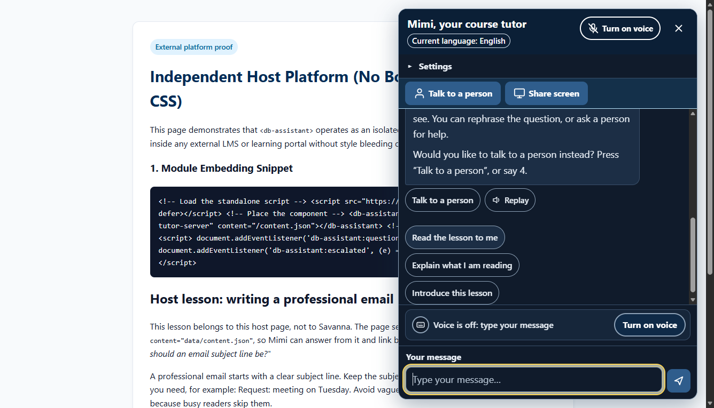

### 6. Explain this: select any text

Select any part of the lesson and an "Explain this" button appears next to it. Mimi explains that exact
passage in simple words, in the learner's language, citing its section.

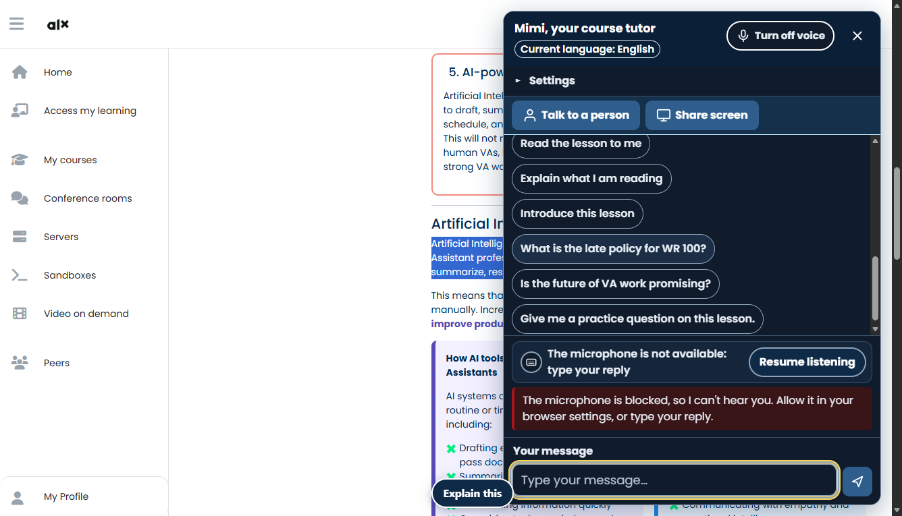

### 7. Read the lesson to me

Mimi goes through the lesson section by section: she outlines the section on the page, explains it in a
few simple sentences, and waits for "next", "repeat" or "stop" (spoken, or as buttons).

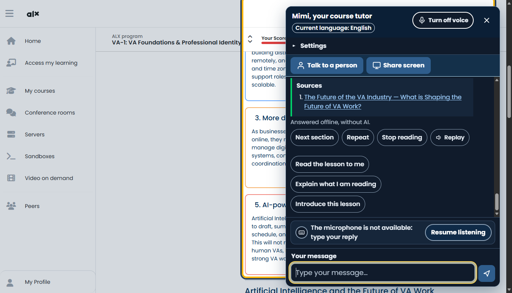

### 8. Settings the learner controls

Language, **answer level** (Simple, Standard or Detailed: the same sources at every level), online AI
and voice on or off, three text sizes, listen automatically, download the chat, clear the chat. The
choices are remembered on the learner's own device.

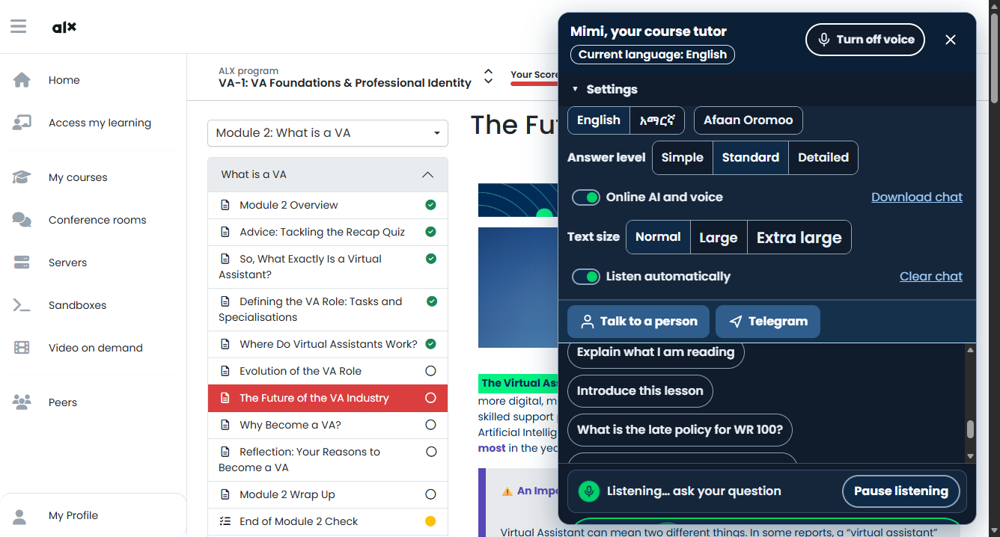

### 9. On a phone

On a phone the chat fills the visible screen, with large text and 44-pixel controls, even on host pages
that are wider than the phone. Tested at 320, 360, 390 and 412 pixels wide, at every text size.

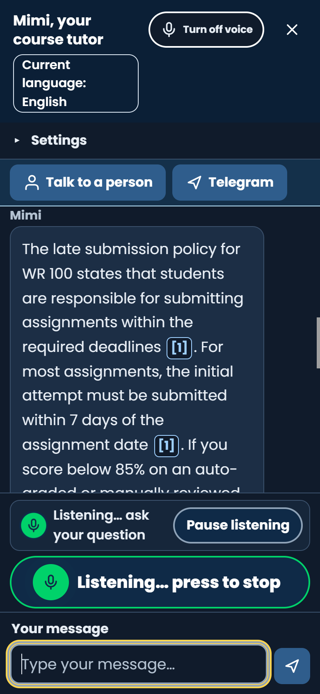

### 10. A real person, one click away

"Talk to a person" opens a live chat with a tutor. The tutor sees the conversation with Mimi so far, so
the learner does not have to repeat anything. The learner can also share their screen, with a visible
stop button.

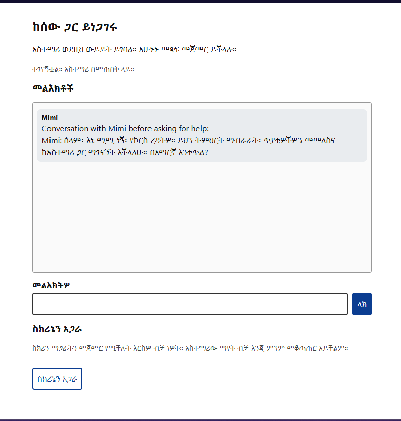

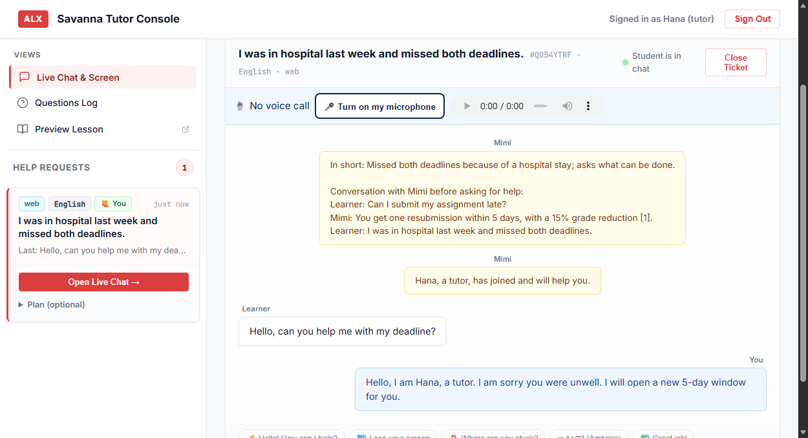

### 11. Telegram, by text or by voice

The same tutor on Telegram. Send a voice message in Amharic or English: Mimi shows what she heard,
answers in text with sources, and replies by voice. Every answer has a "🔊 Listen" button. Off-topic
questions get "I don't know" and `/human` connects to a tutor in the same console.

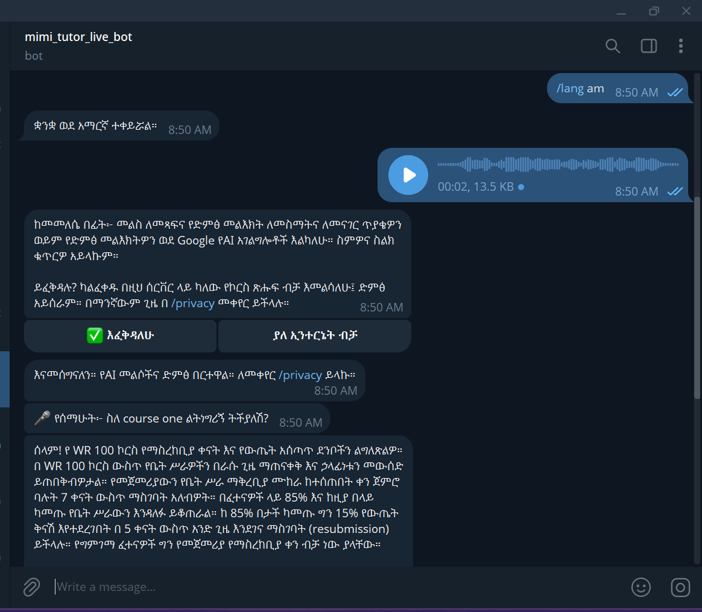

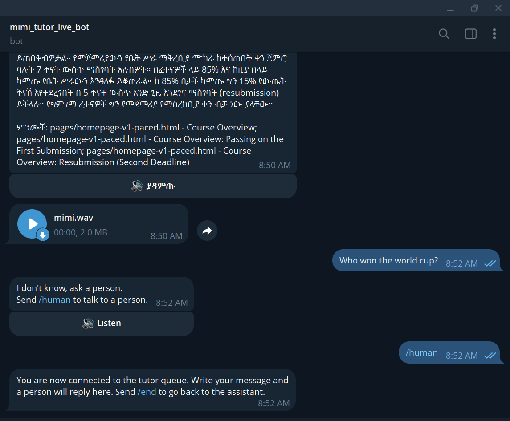

### 12. SMS and a no-JavaScript page, for the slowest phones

By SMS, answers fit in one message (160 characters). `/lite` is a plain HTML form with no JavaScript at
all, for very slow connections.

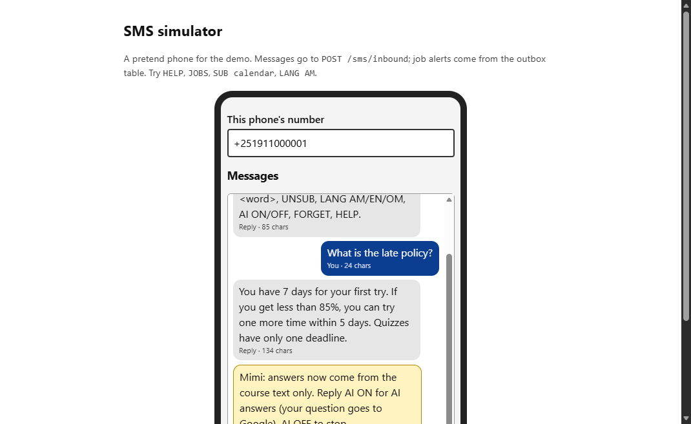

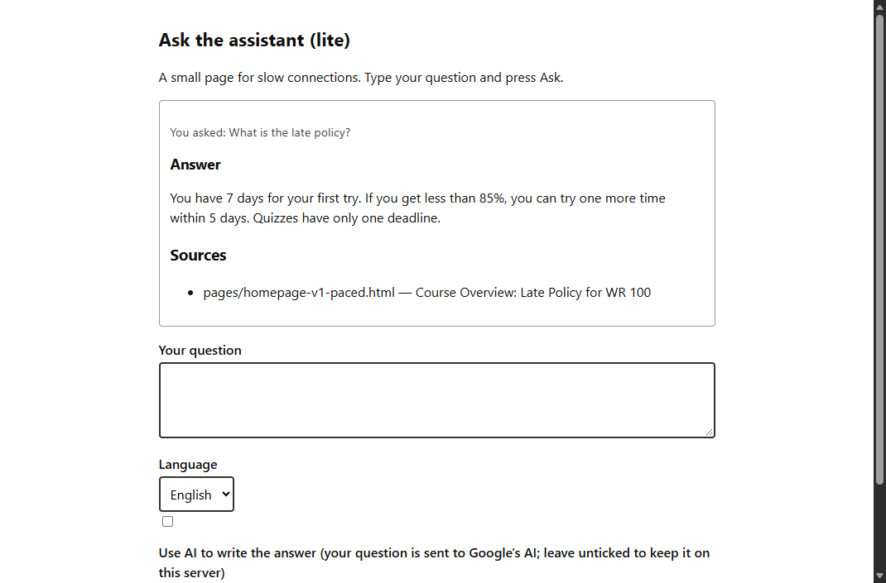

### 13. Jobs, with accessibility built in

The job board lists remote jobs in English and Amharic, each with "Listen to summary" and "Request
accommodation" (handled privately by a person, never shown to the employer). Every job is described
in schema.org JobPosting.

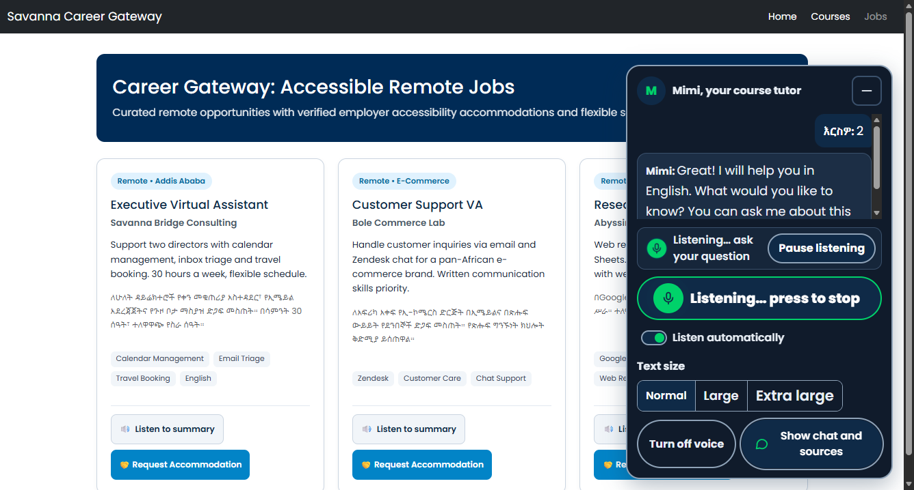

### 14. What learners ask, with no names

The teacher view shows the most-asked questions and the ones Mimi could not answer (the gaps in the
course), by language and channel. Only the question text, language, channel and date are kept: no
names, phone numbers or chat ids.

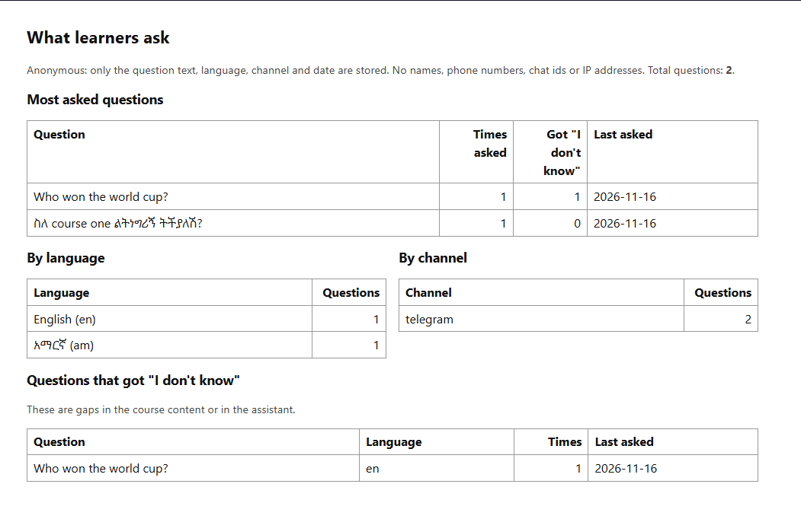

## Run it

### Quick start with Docker (one command)

You need [Git](https://git-scm.com/downloads) and [Docker Desktop](https://www.docker.com/products/docker-desktop/) (running).

```bash
git clone https://github.com/tsionbirhanu/mimi-tutor.git
cd mimi-tutor
cp .env.example .env          # Windows PowerShell: copy .env.example .env
docker compose up --build
```

No key is needed: with an empty `.env`, Mimi answers from the course text (offline mode). Then open:

| Address | What |
|---|---|
| http://localhost:8000/pages/concept-with-navigation.html | **Start here:** a Savanna lesson page with Mimi |
| http://localhost:8000/demo/blank.html | Mimi on a plain page with no Savanna or Bootstrap styles (the "works anywhere" proof) |
| http://localhost:8000/pages/jobs.html | Job board demo (schema.org JobPosting) |
| http://localhost:8000/docs | The API contract, interactive (Swagger UI) |
| http://localhost:8000/api-docs | Every route, generated by FastAPI |
| http://localhost:8000/handoff/console | Tutor console: learners waiting for a person, and accommodation requests |
| http://localhost:8000/teacher | Teacher view: most asked questions, no names |
| http://localhost:8000/lite | Low-bandwidth page, no JavaScript |
| http://localhost:8000/sms/simulator | Pretend phone for the SMS route |

Sign in to the tutor console with a name and password: **tutors** are listed in `TUTORS`
(`Hana:password1,Abel:password2`), the **coordinator** uses `ADMIN_PASSWORD` (or, in older setups,
`TUTOR_PASSWORD`). If none is set, a random coordinator password is printed in the log when the server
starts. A tutor presses **"Take this request"**: the learner sees "Hana, a tutor, has joined", and other
tutors see "Hana is helping". Only the coordinator sees the teacher analytics and the interview
accommodation requests. Stop everything with `Ctrl+C`, then `docker compose down`.

### Without Docker

You need **Python 3.11 or newer** ([python.org](https://www.python.org/downloads/); on Windows tick
"Add Python to PATH").

```bash
git clone https://github.com/tsionbirhanu/mimi-tutor.git
cd mimi-tutor
python -m venv .venv
# Windows:      .venv\Scripts\activate
# macOS/Linux:  source .venv/bin/activate
pip install -r requirements.txt
cp .env.example .env          # Windows PowerShell: copy .env.example .env
python run.py
```

`run.py` starts the **one Mimi server** (FastAPI) on port 8000: the pages, Mimi, the AI answers and
voice, talk to a person, Telegram, SMS, `/lite`, jobs and the teacher view. The addresses are the same as
above. `python server/app.py` does the same.

### First visit: what to expect

1. Mimi asks once, in Amharic and English, whether she may use online AI and voice. Choose
   **"Allow and start"** to hear her, or **"No, text only"** to keep everything on this computer.
2. She introduces herself in Amharic and asks if you want English: say or press **2** for English.
3. Ask a question by voice (the big "Press to talk" button) or by typing. Try *"What is the late
   submission policy?"*, then *"Who won the World Cup?"* (she says it is not in the course and offers
   a person).

Use **Microsoft Edge** for spoken Amharic: it has a natural Amharic voice (Mekdes) built in. **Chrome**
recognises spoken Amharic best. On Windows, `open-demo.bat` opens Edge with sound allowed at once.

### Turn on the extras (all optional, all free to start)

Edit `.env`, then restart (`Ctrl+C`, then `python run.py` or `docker compose up` again). The `.env` can
live in the project folder or one folder up, outside the project (then it can never reach git);
both are read, and the project's own `.env` wins where both set the same thing.

| Feature | What to set in `.env` | Where to get it |
|---|---|---|
| AI answers (better wording, Amharic explanations) | `GEMINI_API_KEY=...` | Free key: https://aistudio.google.com/apikey . One key is enough. |
| Natural Amharic and English voice, and listening, on every device | `AZURE_SPEECH_KEY=...` and `AZURE_SPEECH_REGION=...` | Azure portal: create a "Speech" resource on the free F0 tier |
| AI with no internet | `ABLEWAY_PROVIDERS=local,offline` | Install [Ollama](https://ollama.com), then `ollama pull gemma3:4b` |
| Telegram bot | `TELEGRAM_BOT_TOKEN=...` (and `TELEGRAM_MODE=webhook` on a hosted server, see "Deploy online") | In Telegram, message @BotFather, send `/newbot` |
| Real SMS | `SMS_PROVIDER=...` | See "Real SMS, free for development" below |

### Without a Gemini key (or any AI)

Mimi still answers, from the course text, with the same sources: questions are matched against the
course sections (BM25 and the Amharic and Afaan Oromo word lists) and the best-matching sentences are
quoted, marked "Answered offline, without AI". Off-topic questions are still refused and offered a
person. Three ways to see it:

- **On the live page:** at the first visit choose **"No, text only"** (or turn off "Online AI and voice"
  in Settings). Nothing is sent to any AI from then on.
- **On a server:** leave `GEMINI_API_KEY` empty, or set `ABLEWAY_PROVIDERS=offline`, and restart.
- **In the tests:** `tests/test_judges_feedback.py` removes every key and checks English, Amharic and
  Afaan Oromo answers and the off-topic refusal.

### Test on a real phone (needed for the microphone)

Phones only allow the microphone on HTTPS. With the servers running, open a second terminal:

```bash
cloudflared tunnel --url http://localhost:8000
```

Open the `https://….trycloudflare.com` address it prints, adding `/pages/concept-with-navigation.html`.
Put the same address in `.env` as `PUBLIC_BASE_URL` (and restart), so the help-chat links point to it. Install cloudflared with `winget install --id Cloudflare.cloudflared` (Windows) or
`brew install cloudflared` (macOS).

### Deploy online (Render, free plan)

Everything is **one web service**. Either create a Blueprint from [render.yaml](render.yaml), or create
it by hand with **New → Web Service**, language **Python 3** (not Docker), build command
`pip install -r requirements.txt`, and:

| Setting | Value |
|---|---|
| Start command | `uvicorn server.main:app --host 0.0.0.0 --port $PORT --proxy-headers --forwarded-allow-ips "*"` (or the older `ABLEWAY_HOST=0.0.0.0 ABLEWAY_PORT=$PORT python server/app.py`, which now starts the same server) |
| Health check path | `/api/health` |
| `GEMINI_API_KEY` | your key (the web page, Telegram and SMS all use it) |
| `ABLEWAY_PROVIDERS`, `ABLEWAY_GEMINI_MODEL` | `gemini,offline`, `gemini-3.5-flash-lite` |
| `PUBLIC_BASE_URL` | the service's own address, e.g. `https://mimi-tutor.onrender.com` |
| `TUTORS` | the tutors, each with their own name and password: `Hana:password1,Abel:password2` |
| `ADMIN_PASSWORD` | the coordinator's password (analytics, accommodation requests, take over a request). Without it, `TUTOR_PASSWORD` signs in as the coordinator |
| `TELEGRAM_BOT_TOKEN`, `TELEGRAM_MODE` | a bot made for the hosted server (keep a separate bot for your laptop), `webhook` |

`CHANNELS_URL` is no longer needed: "Talk to a person" opens the ticket on the same server. (Set it only
to send tickets to a help desk that runs separately.) Addresses have no `/` at the end. With
`TELEGRAM_MODE=webhook`, Telegram sends each message to the server, which also wakes it;
`https://<your service>/telegram/status` should then show `"running": true, "mode": "webhook"`. On the
free plan the service sleeps after 15 minutes without visits; the first request after that (a page,
"Talk to a person", a Telegram message) takes up to about a minute. Open it once before a demo. Data in SQLite is reset when a free service restarts.

**Monitoring and automatic restart.** `GET /api/health` answers **200** when Mimi can answer and the
help desk can take learners (`"help_desk": {"ok": true, "waiting": 0, "telegram": "running"}`), and
**503** when the help desk cannot (for example, its database cannot be opened).
- **Render** uses it as the health check (`healthCheckPath` in render.yaml) and restarts the service when it fails.
- **Docker Compose** restarts the container if it stops and marks it "unhealthy" when the check fails.
- **A free uptime monitor** (for example UptimeRobot or Better Stack) checking
  `https://<your service>/api/health` every 5 minutes e-mails the team when it fails. It also keeps a
  free Render service awake, so the first learner does not wait.

### Real SMS, free for development

Without an SMS gateway, `POST /sms/inbound` returns the reply as plain text (at
most 160 characters) and `/sms/simulator` plays the phone. To send and receive real SMS:

- **SMS Gateway for Android** (free, open source): install the app from https://sms-gate.app on an
  Android phone with a SIM card. Each SMS costs only what the SIM plan charges. In `.env`:
  `SMS_PROVIDER=android`, `SMS_GATEWAY_URL` (the address the app shows, for example
  `http://192.168.1.20:8080`, or `https://api.sms-gate.app/3rdparty/v1` for its cloud mode),
  `SMS_GATEWAY_USER`, `SMS_GATEWAY_PASSWORD`. In the app, add a webhook for `sms:received` pointing
  to `https://<your tunnel>/sms/webhook/android`.
- **Africa's Talking sandbox** (free, with a phone simulator in their dashboard): `SMS_PROVIDER=africastalking`,
  `AT_USERNAME=sandbox`, `AT_API_KEY` from the sandbox app. Set the incoming SMS callback to
  `https://<your tunnel>/sms/webhook/africastalking`.

Job alerts then go out as real SMS too. Commands a learner can text: `JOBS`, `SUB <word>`, `UNSUB`,
`LANG AM`, `LANG EN`, `AI ON`, `AI OFF`, `FORGET`, `HELP`.

### Run the tests

```bash
pip install -r requirements.txt
python -m pytest server/tests tests     # 155 tests
python server/evaluate.py               # answer quality: 30 questions, see "Quality" below
cd tests/a11y && npm install && node axe.mjs http://localhost:8000/demo/blank.html page open
```

### If something goes wrong

| Problem | Fix |
|---|---|
| `Port 8000 is already in use` / `address already in use` | Another copy is running. Close its window, or press `Ctrl+C` there. |
| `No module named fastapi` / `uvicorn` | The virtual environment is not active, or `pip install -r requirements.txt` was not run. |
| `python` is not recognised (Windows) | Reinstall Python and tick "Add Python to PATH", or use `py` instead of `python`. |
| Mimi is silent | Browsers hold sound until the first tap or key press: press "Start Mimi". In Chrome there is no Amharic voice without an Azure key; use Edge. |
| "Listening" but nothing is written | Allow the microphone (the icon in the address bar). On a phone, use the HTTPS tunnel. |
| Answers say "working offline" | No AI key, or the free Gemini quota is used up for today (`API error 429` in the log). It resets at midnight Pacific time. |
| Telegram shows `"configured": false` at http://localhost:8000/telegram/status | `TELEGRAM_BOT_TOKEN` is missing from `.env`, or the server was not restarted after adding it. |
| The bot answers on the laptop but not online (or the other way round) | Both use the same bot token: only one place can receive its messages. Use one bot for the laptop and another for the hosted server. |
| "Talk to a person" fails online | `PUBLIC_BASE_URL` is not the service's own address, or the service is still waking up: try again after a minute. If `CHANNELS_URL` is set, remove it. |
| `cloudflared` / `ollama` not recognised | Close and reopen the terminal after installing (or VS Code entirely). |

## Install, Level 1: one script tag

```html
<script src="https://your-server/module/db-assistant.js" defer></script>
<db-assistant lang="am" api="https://your-server" content="/content.json"></db-assistant>
```

| Attribute | Meaning | Default |
|---|---|---|
| `lang` | Language Mimi starts in (`am` or `en`); she then asks whether to switch | `am` |
| `api` | The tutor server | the server the page came from |
| `content` | A JSON file of the host's own lessons, `[{"title", "url", "text"}]`, indexed so Mimi answers from them too | none |
| `course`, `lesson` | The course and lesson on this page, so "explain this lesson" knows what "this" is | none |
| `lesson-selector` | A CSS selector whose text is the current lesson (for pages that change it) | none |
| `auto-welcome` | `false`: Mimi does not speak until the learner opens her | `true` |
| `consent` | `given`: the platform already asked this learner (for example at sign-up) and they agreed to online AI and voice, so Mimi does not ask again. Use it only if the platform really asked. | not set: Mimi asks |
| `theme` | `light`, `dark`, or `auto`: follow the phone or computer's dark setting | `auto` |
| `tts`, `stt` | `browser` or `server`: force where speech is made and recognised | `auto` |

| Event (on `document`) | `detail` | When |
|---|---|---|
| `db-assistant:question` | `{ text, language }` | The learner asks something |
| `db-assistant:escalated` | `{ ticketId }` | The learner asked for a person |

Mimi lives in a shadow root (the host's CSS cannot change her, hers cannot change the host), sets no
global variables and changes no host element. She uses the host's font (`--bs-body-font-family`) when
there is one, and keeps herself on screen even on a host page that is wider than the phone.

## Install, Level 2: the API

The full specification is [openapi.yaml](openapi.yaml); try every call at `/docs`.

```bash
# Ask (answers only from the course, with sources). "cloud": false if the learner did not agree to a cloud AI.
curl -X POST http://localhost:8000/api/v1/ask -H "Content-Type: application/json" \
  -d '{"question":"Can I resubmit an assignment?","language":"en"}'

# Send the host's lessons to be indexed
curl -X POST http://localhost:8000/api/v1/content -H "Content-Type: application/json" \
  --data-binary @demo/data/content.json

# Ask for a person, with the conversation so far
curl -X POST http://localhost:8000/api/v1/escalations -H "Content-Type: application/json" \
  -d '{"language":"en","conversation":[{"role":"user","text":"When is the deadline?"}]}'

# The text route: an SMS gateway posts here and sends back the plain-text reply (at most 160 characters)
curl -X POST http://localhost:8000/sms/inbound -H "Content-Type: application/json" \
  -d '{"from":"0911000000","text":"What is the late policy?"}'

# Which AI and voices are available
curl http://localhost:8000/api/health
```

**Webhook.** Set `WEBHOOK_URL` in `.env`: the server posts `{"event", "at", "data"}` to it when a
learner asks for a person (`ticket.opened`) or sends an interview accommodation request
(`accommodation.requested`). No name, phone number or message text is sent.

**AI providers.** One switch in `.env`, `ABLEWAY_PROVIDERS`, in order of preference: `gemini` (cloud),
`local` (an open model through Ollama, no internet) and `offline` (keyword search and a hand-written
FAQ, no AI). Missing keys are skipped, and offline is always last, so Mimi is useful with no AI budget
at all. A new provider is one class in `server/providers.py`.

## Install, Level 3: open standards

- **schema.org JobPosting:** every job on `pages/jobs.html` is described in JSON-LD, so job boards and
  search engines can read it.
- **LTI 1.3:** not done. Mimi would connect as an LTI tool whose launch page loads the same script tag;
  the LMS would pass the course and lesson as launch claims, which map to the `course` and `lesson`
  attributes. No learner identity is needed for answers.

## The AI: grounded RAG, built for Amharic

Mimi is a **retrieval-augmented generation (RAG)** tutor. The AI never answers from what it happens
to know: every answer is built from the learner's own course pages, every claim is tied to a numbered
source, and a question the course does not cover never reaches the AI at all.

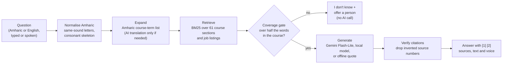

**The pipeline, step by step:**

1. **Split the course by its headings** (`server/extract.py`). Each of the 61 sections keeps its title
   and its anchor on the page, so a citation links to the exact place in the lesson.
2. **Normalise Amharic** (`server/retrieval.py`). Letters that sound the same are treated as one
   (ሥራ = ስራ, ፀ = ጸ, ሐ = ኀ = ሀ, ዐ = አ), and every word is also compared by its consonants only, so a
   vowel that speech recognition gets wrong (ማሰረከቢያ for ማስረከቢያ) still finds the right section.
3. **Expand the question.** Amharic questions are turned into English search words with a 78-term
   course word list (`server/data/glossary_am.json`). Only when the list does not understand enough of
   the question does an AI translation step run, which keeps spoken turns fast.
4. **Retrieve with BM25,** a proven ranking method that rewards rare, specific words like "resubmission"
   or "deadline". Course sections come first; job listings join only for job questions.
5. **Coverage gate.** If more than half of the question's words are not in the matched course text, it
   is not a course question: Mimi says so and offers a person, **without calling the AI**. This stops
   made-up answers and saves cost.
6. **Generate, grounded.** Only the matched sections go to the AI, with a tutor prompt: answer only from
   these sources, cite each sentence `[n]`, reply in the learner's language, plain words, no Markdown
   (it may be spoken). Course text is treated as content, never as instructions, which protects against
   prompt injection hidden in a page.
7. **Verify the citations** (`parse_answer` in `server/tutor.py`). A source number the AI invented is
   removed, the rest are renumbered, and an answer with no real citation is not shown as sourced.
8. **Cache.** Identical questions on the same section reuse the answer for a day, so popular questions
   cost nothing after the first time.

**Three ways to answer, one switch.** `ABLEWAY_PROVIDERS` lists the AI providers in order of
preference: `gemini` (Gemini Flash-Lite in the cloud, free tier), `local` (an open model such as
Gemma through Ollama, with no internet) and `offline` (no AI: the best-matching course sentences are
quoted directly, with the same sources). If one fails or runs out of quota, the next answers, so Mimi
keeps working with no AI budget at all. The learner's consent decides whether cloud providers may be
used.

**Beyond questions and answers.** The same retrieval powers "Explain this" (the selected passage and
its section), "Read the lesson to me" (section by section), and the smart hand-off: after "I don't
understand" or a second question the course cannot answer, Mimi offers a tutor, and the AI writes a
one-sentence summary of the problem for the tutor (only with consent).

**Why keyword retrieval (BM25) and not a vector database?** For a course of this size it is the
better choice: course questions use the course's own words ("resubmission", "85%", "WR 100"), which
keyword search matches exactly; good embedding models for Amharic are scarce, while our Amharic
normalisation and word list are built for the language; it runs with no GPU and no internet, so the
offline mode works; and every match can be explained. The retriever is one class, so a vector or
hybrid search can be added later without changing anything else.

**Voice.** Spoken answers use Microsoft Edge's natural Amharic voice (Mekdes) and English voices in the
browser, or Azure Speech and Gemini on the server. Before speaking, abbreviations and numbers are
rewritten so they sound right (AI → ኤ አይ, 85% → 85 በመቶ).

**Consistent Amharic.** The AI uses a fixed list of Amharic course terms, so the learner always hears
the same word for "deadline" or "assignment", whichever question they ask.

**Measured.** `python server/evaluate.py` asks 30 questions (15 English, 10 Amharic including a
misspelled one, 5 off-topic) and checks the cited section:

| Mode | Right source | Refused off-topic | Total |
|---|---|---|---|
| Offline (no AI), measured 15 November 2026 | 25 / 25 | 5 / 5 | **30 / 30** |
| With Gemini (`--cloud`) | *not measured yet: the free daily quota was used up during testing; run it after the reset* | | |

## Languages and how to add one

Every sentence Mimi says or shows is in [module/i18n/en.json](module/i18n/en.json) and
[module/i18n/am.json](module/i18n/am.json); none is written in the code. To add a language (for
example Tigrinya, Afaan Oromo, Somali or Arabic):

1. Copy `en.json` to `module/i18n/<code>.json` and translate it. Set `meta.speech` (for example
   `ti-ET`) and `meta.dir` (`rtl` for Arabic: the layout uses logical CSS properties, so it mirrors).
   Add the words that language's voice mispronounces to `pronounce`.
2. Add the code to `LANGUAGE_CODES` in `module/db-assistant.js`.
3. On the server, add the language name in `LANGUAGES` in `server/tutor.py`, so AI answers come in it.

Right-to-left text already works in any language: every message has `dir="auto"`. Job deadlines are
shown in the Ethiopian calendar in Amharic (`server/channels/ethiopian.py`), and phone numbers in any
form (`09…`, `07…`, `+251…`) are stored as `+251…`.

## Offline and slow connection

- Measured on Chrome's "Slow 3G" setting (2 s latency, about 400 kbit/s), cache off: Mimi appears after
  **7.5 s** on the plain page (measured 16 November 2026). On the Savanna lesson page it is about 21 s,
  because the browser first loads Savanna's own 1.5 MB of stylesheets.
- The module is **53 KB** compressed (script 37 KB, stylesheet 9 KB, two language files 7 KB).
- **No signal on the phone:** a question is kept on the phone, Mimi says "Saved on this phone. It will
  send when you are online.", and sends it by itself when the connection is back.
- With no internet on the server, answers still come from the offline search and FAQ.
- `/lite` is a plain HTML form for the slowest phones, and SMS works with no data at all.

## Data and privacy

| What | Where | Kept | How to delete |
|---|---|---|---|
| The conversation | The learner's browser tab only (`sessionStorage`); the server keeps nothing between questions | Until the tab closes | "Clear chat"; "Download chat" gives the learner a copy |
| Language, display and consent choices | The learner's browser (`localStorage`) | Until the learner clears it | The browser's "clear site data" |
| Questions saved while offline | The learner's browser (`localStorage`) | Until sent | Sent and removed automatically |
| Questions for the teacher view | `channels.db`: text, language, channel and date. No name, phone number, IP or time | Kept for the teacher view | Delete the database file |
| Help tickets and live chat | `channels.db` | Until closed | Telegram `/forget` and SMS `FORGET` remove the link to the learner |
| Telegram and SMS choices, job alert subscriptions | `channels.db`: the chat id or number, language, consent, keywords | Until deleted | Telegram `/forget`, SMS `FORGET` (everything), `UNSUB` (alerts only) |
| Interview accommodation requests | A separate database, `accommodations.db`, seen only by signed-in staff at `/accommodation/requests`, never by employers | Until a person handles it | "Mark as handled" deletes it |

- **Nothing leaves the host without the learner's consent.** Before Mimi speaks or sends anything, she
  asks once, in Amharic and English: online AI and voice (Google, Microsoft), or text from the course
  only. Until the learner answers, nothing is spoken, sent or recorded. With "No", questions are
  answered from the course text on the host (or a local model), only voices built into the device are
  used, and there is no listening. The choice can be changed at any time ("Online AI and voice" in the
  chat settings, `/privacy` on Telegram, `AI ON` / `AI OFF` by SMS, a tick box on `/lite`, unticked by
  default). API clients send `"cloud": false` when the learner has not agreed.
- What leaves the server after consent: the question and the matching course text go to the AI
  provider the host configured (Gemini's free tier may use them to improve Google's products; use a
  paid tier or the local or offline provider to avoid that). Voice goes to the speech service (Azure or
  Gemini on the server; in Edge, Microsoft's online voices).
- On a phone, Mimi does not start talking until the learner's first tap, so she never talks over
  TalkBack or VoiceOver reading the page.
- The microphone and screen sharing are off until the learner starts them, and clearly shown while on.
- Keys stay on the server in `.env`, which is not in git; the browser never sees them.
- Only test data is included: the jobs and learners are invented.

## Cost to run per month

For 3,000 learners, assuming 5 questions each per week (about 65,000 questions a month):

| Item | Cost |
|---|---|
| Server: one small virtual machine (2 GB) running both containers | about $6–12 |
| AI answers: off-topic questions never reach the AI, repeated questions come from the answer cache, and the rest (roughly 30,000) go to a Flash-Lite class model at about 2,500 tokens in and 250 out | about $25–45 (check current prices) |
| Voices: browser voices (Edge) and recorded phrases | $0 |
| Optional: Azure Speech free tier (0.5 M characters of speech, 5 hours of recognition a month) | $0 within the free tier |
| SMS: SMS Gateway for Android on a phone with a local SIM package | the SIM plan only |
| **Total** | **about $30–60**, or the server cost only with the offline provider |

No feature depends on a paid service: every AI, voice and SMS provider can be swapped or removed.

## Finished and not finished

**Finished and tested:**

- The tutor in Amharic and English: sources on every answer, refusals for off-topic questions, no AI
  call when the course has nothing, 30/30 on the evaluation set offline.
- **Explain what I am reading:** select any part of the lesson and press "Explain this" (or choose
  "Explain what I am reading"), and Mimi explains that exact passage in the learner's language, citing
  its section.
- **Read the lesson to me:** Mimi goes through the lesson's own sections, outlines each one on the
  page, explains it in a few simple sentences by voice and text, and waits for "next", "repeat" or
  "stop" (spoken or as buttons).
- **Knowing when a person is needed:** after "I don't understand", or a second question that is not in
  the course, Mimi offers a tutor herself; the tutor's ticket starts with a one-sentence summary of
  the problem (written by the AI only with the learner's consent).
- Voice in and out, with captions. Consent before anything leaves the host. Silence until the first
  tap on phones.
- One-click help with the conversation passed on; screen sharing with a visible stop control.
- Telegram: typed questions and voice messages, "🔊 Listen", `/voice on`, `/privacy`, `/forget`.
- SMS (plain text, 160 characters) with real gateways for development; `/lite`.
- Job answers, job alerts, interview accommodation requests handled by a person.
- Answer level (Simple, Standard, Detailed, same sources), teacher view, offline question queue, "Download chat".
- Text size in three steps, dark mode (following the device, or `theme`), the host's brand colour
  when readable; Mimi stays inside the visible screen on phones, even on pages wider than the phone
  (tested at 320, 360, 390 and 412 px, at every text size).
- Quick spoken turns: the turn ends after 1.2 s of silence, Amharic questions the word list understands
  skip the extra AI step, and "Let me check." when an answer takes a moment.
- The pluggable AI layer with an offline mode; the API with `/docs`, OpenAPI and a webhook;
  schema.org JobPosting; Docker Compose; a Render blueprint, with Telegram by webhook when hosted.
- 155 automated tests (`python -m pytest server/tests tests`) and an axe-core check (`tests/a11y`):
  0 issues on every page, with the chat open and closed.

**Not finished or not yet verified:**

- Not yet tested by blind users with NVDA and TalkBack (see [CONFORMANCE.md](CONFORMANCE.md)).
- The local model (Ollama) path is built and covered by tests, but not yet run with Ollama installed.
- Amharic speech recognition is good but not perfect; names and places are often wrong. Mimi always
  shows what she heard, so the learner can correct it or type instead.
- Only Amharic and English language files; the mechanism for more is in place.
- The real SMS gateways are tested with simulated requests only, not yet with a real phone and SIM.
- The Amharic text should be read once more by a native speaker on the team: run
  `python server/amharic_review.py` and fill in [docs/amharic_review.csv](docs/amharic_review.csv)
  (every Amharic text next to its English, including the fixed course terms the AI must use).

## Project structure

| Path | What it is |
|---|---|
| `module/` | **The module the host loads:** `db-assistant.js`, `db-assistant.css`, `i18n/en.json`, `i18n/am.json` |
| `pages/`, `assets/`, `index.html` | The Savanna starter (unchanged except the two lines that load Mimi), plus `pages/jobs.html` |
| `demo/` | `blank.html`: Mimi on a plain page; `data/content.json`: sample host lessons |
| `server/main.py` | **The one server** (FastAPI, port 8000): every route below |
| `server/tutor_api.py` | The tutor's routes in it: the pages, `/api/v1/*`, voice, `/docs`, `/openapi.yaml` |
| `server/tutor.py`, `retrieval.py`, `providers.py` | Retrieval, the prompt and citation check, the AI providers |
| `server/speech.py` | Voice and listening on the server (Azure, Gemini, Google) |
| `server/channels/`, `handoff/`, `jobs/`, `teacher/` | Telegram, SMS, `/lite`, talk to a person, jobs, teacher view |
| `server/app.py` | Starts the server too (kept so older start commands keep working) |
| `server/data/` | The course split into sections (`chunks.json`, made by `extract.py`), job chunks, FAQ, Amharic word list, the evaluation questions |
| `data/jobs.json` | Test job listings (invented) |
| `tests/`, `server/tests/` | Automated tests; `tests/a11y/axe.mjs`: the axe-core check |
| `run.py` | Starts the server: `python run.py` |
| `docker-compose.yml`, `Dockerfile`, `render.yaml` | Run with Docker; deploy on Render |
| `open-demo.bat` | Opens Edge with sound allowed, for demos |
| `docs/screenshots/` | The screenshots in this README |
| `LICENSE` | The MIT licence |

## Libraries

| Library | Used for | Licence |
|---|---|---|
| FastAPI, Uvicorn | Help desk server | MIT, BSD-3-Clause |
| Jinja2, python-multipart, httpx, python-dotenv | Help desk server | BSD-3-Clause, Apache-2.0, BSD-3-Clause, BSD-3-Clause |
| pytest | Tests | MIT |
| Swagger UI 5.17.14 (from jsDelivr, on `/docs` only) | API documentation page | Apache-2.0 |
| axe-core 4.10.2 (tests only) | Accessibility check | MPL-2.0 |
| lameenc (optional, not installed by default) | Converts Gemini's voice to MP3 for Telegram voice messages | LGPL-3.0 |

The tutor server and the module itself use only the Python standard library and plain JavaScript.

## Licence

Mimi (the module, the servers, the tests and this documentation) is released under the
[MIT licence](LICENSE). The Savanna starter pages and assets belong to ALX (see
[docs/SAVANNA_STARTER.md](docs/SAVANNA_STARTER.md)) and are not covered by it; we added only the two
lines that load Mimi to each page. The third-party files in `assets/` (Bootstrap, Popper, Font
Awesome and others) keep their own licences, written at the top of each file.
